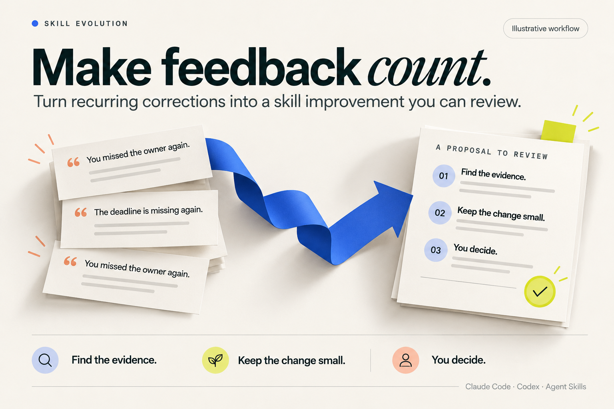

# Skill Evolution — improve Claude Code and Codex skills from real feedback

**Stop teaching your agent the same lesson twice.**

Turn recurring corrections into a small, reviewable improvement to an Agent Skill or workflow. Get the evidence, the suggested change, and a way to check it. You decide what gets applied.

[Install in Claude Code](#install-in-claude-code) · [Install in Codex](#install-in-codex) · [Download the Claude ZIP](https://raw.githubusercontent.com/rwang23/skill-evolution/main/skill-evolution.zip) · [Let your agent install it](#let-your-agent-handle-the-setup) · [中文](README.zh-CN.md)



## Make your feedback useful beyond this conversation

You corrected the missing owner last time. The next handoff misses it again. Adding another rule immediately may make the Skill longer without fixing the cause.

Skill Evolution helps you work out what should change:

- **Find the recurring problem.** Trace a suggestion back to the relevant feedback and tool result.
- **Keep the fix small.** Identify the Skill instruction, reference, script, or check that needs attention.
- **Compare your options.** Review a focused change alongside a regression-first or observe-more alternative.
- **Know when to leave it alone.** A one-off request or weak evidence can return `no candidate`.


*Illustrative workflow with sample data. [View the still image](assets/skill-evolution-demo-poster.png).*

## Install in Claude Code

With Git and Node.js 18+ available, run this in your terminal:

```sh
git clone https://github.com/rwang23/skill-evolution.git "$HOME/.claude/skills/skill-evolution"
```

Works in Bash and PowerShell. If that directory already exists, follow the [update instructions](INSTALL.md#update-or-remove) instead of overwriting it.

Start a new Claude Code session and try:

```text
/skill-evolution
Try the bundled repeated-feedback example. Show me the evidence, compare a
small fix with a regression-first option, and leave all changes for my review.
```

Then bring a relevant conversation from your own work:

```text
/skill-evolution
Review the repeated corrections in this conversation. What is the smallest
reusable improvement? Show the source evidence and a check that would catch
the same mistake next time. Keep the target Skill unchanged.
```

## Install in Codex

Install once for your local Codex projects. With Git and Node.js 18+ available, run:

```sh
git clone https://github.com/rwang23/skill-evolution.git "$HOME/.agents/skills/skill-evolution"
```

Works in Bash and PowerShell. If you already have this skill installed, reuse it and follow the [update instructions](INSTALL.md#update-or-remove). For a project-only installation, use `.agents/skills/skill-evolution` inside that project instead. [More installation options](INSTALL.md#codex).

Open Codex and try:

```text
$skill-evolution
Try the bundled repeated-feedback example. Show me the evidence, compare a
small fix with a regression-first option, and leave all changes for my review.
```

Codex discovers new skills automatically. If the skill does not appear, restart Codex. [Official OpenAI skill guide](https://learn.chatgpt.com/docs/build-skills).

## Let your agent handle the setup

Copy this into Claude Code, Codex, or another agent with local file access:

```text
Install https://github.com/rwang23/skill-evolution for my agent.
Follow INSTALL.md in that repository. Reuse an existing installation and
preserve local edits. Verify the installed package and run its bundled example.
Tell me where it is installed and how to invoke it. Do not enable hooks or
apply any evolution proposal.
```

## Use it with your preferred agent

| Your setup | Start here |
| --- | --- |
| **Claude Code** | Install above; invoke `/skill-evolution`. Personal and project scopes are supported. |
| **Claude web / Cowork** | [Download the skill ZIP](https://raw.githubusercontent.com/rwang23/skill-evolution/main/skill-evolution.zip), upload it under Customize → Skills, and enable it. Requires code execution with Node.js 18+. [Steps](INSTALL.md#claude-web-and-cowork). |
| **Codex** | [Install above](#install-in-codex); invoke `$skill-evolution`. Personal and project scopes are supported. [Steps](INSTALL.md#codex). |
| **Another Agent Skills runtime** | Use the same folder with its root `SKILL.md`; confirm the runtime supports local scripts. [Compatibility](references/agent-compatibility.md). |

The download is a small runtime-only ZIP, ready for Claude's skill-upload flow. Its structure and extracted scripts are tested locally; availability and execution in your Claude account depend on that environment.

## What you get

A review you can act on:

| In the review | Why it helps |
| --- | --- |
| Source excerpts and locations | Check whether the suggestion matches what actually happened. |
| The smallest reusable target | Avoid turning a local correction into a rule for everything. |
| Alternatives and tradeoffs | Choose a narrow fix, add a regression check first, or wait for more evidence. |
| A validation plan | Know what would demonstrate that a later change helped. |
| A pending approval | Keep control of your Skills and workflow. |

The bundled helpers save JSON and Markdown. Your agent reviews the source context and turns that draft into a specific recommendation. A generated signal is a lead to examine.

## Good moments to use it

- The same correction keeps coming up across handoffs, reviews, or coding sessions.
- A Skill triggers for the wrong task, misses a required step, or produces an output you keep repairing.
- You are about to update a shared Skill and want an evidence-backed reason for the change.
- A model or client update makes you question whether an existing Skill still helps.

For creating a new Skill, use your authoring workflow. For an immediate one-file fix, handle that task directly. Skill Evolution is the review step before a reusable behavior changes.

## Your conversations and changes stay under your control

Choose the transcript or excerpt to review. The helpers run locally, redact supported credential and user-path patterns in proposal excerpts, and keep target files unchanged. Review sensitive content before sharing; your chosen agent provider handles whatever context you send it.

There is no background history scan or automatic Skill rewrite. Node.js 18+ is the only helper runtime; no extra npm packages, separate service, or additional API key is needed.

[Installation and updates](INSTALL.md) · [How evidence is reviewed](references/evolution-loop.md) · [Quality contract](references/skill-quality-contract.md) · [Development and checks](docs/agent-brief.md) · [MIT license](LICENSE)
