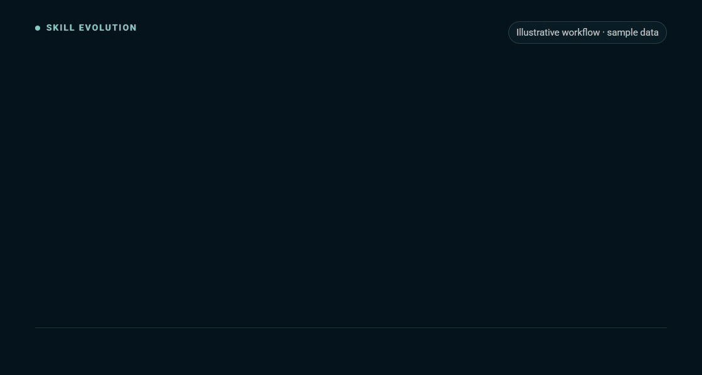

# Skill Evolution：用真实反馈改进 Claude Code 和 Codex 的技能

**让你反复说过的纠正，成为下一次改进的依据。**

Skill Evolution 帮你从对话中找出重复问题，提出一份范围明确、能回查证据、带验证方法的 Agent Skill 或工作流改进建议。你看过以后，再决定改什么。

[安装到 Claude Code](#安装到-claude-code) · [下载 Claude 安装包](https://raw.githubusercontent.com/rwang23/skill-evolution/main/skill-evolution.zip) · [交给 Agent 安装](#交给-agent-安装) · [English](README.md)



*动图使用示例数据说明工作方式。[查看静态图](assets/skill-evolution-demo-poster.png)。*

## 少做几次重复纠正

上次交接漏了负责人，你已经提醒过；下一次又漏了。直接给 Skill 加一条规则，未必能解决原因，还可能让说明越来越长。

Skill Evolution 帮你先把问题看清楚：

- **找出反复出现的失误。** 建议能回到对应的用户反馈和工具结果，不靠印象判断。
- **把修改范围缩小。** 确认该改的是哪条指令、哪份参考、哪个脚本或检查。
- **比较几个做法。** 可以先做最小修改，也可以先补回归检查，或再观察一次。
- **允许暂时不改。** 一次性任务或证据不足时，返回 `no candidate`，避免把偶发情况写进长期规则。

## 安装到 Claude Code

准备好 Git 和 Node.js 18+，在终端运行：

```sh
git clone https://github.com/rwang23/skill-evolution.git "$HOME/.claude/skills/skill-evolution"
```

Bash 和 PowerShell 都能使用。如果这个目录已经存在，先按[更新说明](INSTALL.md#update-or-remove)核对，不要覆盖已有修改。

新开一个 Claude Code 会话，先用示例体验：

```text
/skill-evolution
先使用自带的 repeated-feedback 示例，说明有哪些证据，比较最小修改和
先补回归检查两个方案。所有改动都留给我审阅。
```

然后再试自己的对话：

```text
/skill-evolution
复盘这段对话中重复出现的纠正。最小、可复用的改进是什么？
请列出原始证据，以及下次能发现同类问题的检查。保持目标 Skill 不变。
```

## 交给 Agent 安装

把下面这段话交给有本地文件访问能力的 Claude Code、Codex 或其他 Agent：

```text
请为我的 Agent 安装 https://github.com/rwang23/skill-evolution 。
按照仓库里的 INSTALL.md 操作。先查找已有安装，保留本地修改，
验证安装包并运行自带示例。告诉我安装在哪、以后如何调用。
不要启用 hooks，也不要应用任何技能改进提案。
```

## 选择你的使用环境

| 使用环境 | 从这里开始 |
| --- | --- |
| **Claude Code** | 按上面的方式安装，使用 `/skill-evolution`；支持个人目录和项目目录。 |
| **Claude 网页版 / Cowork** | [下载安装包](https://raw.githubusercontent.com/rwang23/skill-evolution/main/skill-evolution.zip)，在 Customize → Skills 中上传并启用。执行环境需要代码执行能力及 Node.js 18+。[详细步骤](INSTALL.md#claude-web-and-cowork)。 |
| **Codex** | 安装到现有技能目录，使用 `$skill-evolution`。[详细步骤](INSTALL.md#codex)。 |
| **其他 Agent Skills 环境** | 使用同一个含根目录 `SKILL.md` 的文件夹，并确认支持本地脚本。[兼容说明](references/agent-compatibility.md)。 |

下载包只包含运行所需内容，按 Claude 的技能上传结构打包。本地已测试压缩包结构和解压后的脚本；你的 Claude 账户能否上传、运行，还取决于相应环境。

## 你会拿到什么

| 审阅内容 | 能帮你做什么 |
| --- | --- |
| 原始摘录和来源位置 | 检查建议是否符合实际发生的情况。 |
| 最小的可复用修改位置 | 避免把局部纠正扩大成所有任务的规则。 |
| 备选方案和取舍 | 决定先小改、先补检查，还是继续观察。 |
| 验证方法 | 知道以后如何判断修改是否有帮助。 |
| 待确认的修改状态 | 保留对 Skill 和工作流的决定权。 |

自带工具会保存 JSON 和 Markdown。Agent 需要回看上下文，把初步线索整理成具体建议；自动识别到的信号仍需核查。

## 什么时候值得用

- 交接、审阅或编码时，同一类问题反复需要你纠正。
- Skill 选错任务、漏掉必要步骤，或者产物总要手工修补。
- 准备调整团队共享的 Skill，希望先确认修改依据。
- 模型或客户端更新后，想检查现有 Skill 是否仍然有帮助。

要新建 Skill，使用你的技能编写流程；要立刻改一个文件，直接处理那个任务。需要改变可复用行为之前，再用 Skill Evolution 做这次审阅。

## 对话和修改由你掌握

由你选择要审阅的会话或片段。工具在本地运行，会对提案摘录中可识别的凭据和用户路径做脱敏，并保持目标文件不变。分享前仍需检查敏感内容；你发给 Agent 的上下文由相应服务处理。

没有后台历史扫描，也不会自动改写 Skill。工具只需要 Node.js 18+，无需额外 npm 包、独立服务或额外 API Key。

[安装与更新](INSTALL.md) · [如何审阅证据](references/evolution-loop.md) · [质量约定](references/skill-quality-contract.md) · [开发与检查](docs/agent-brief.md) · [MIT 许可](LICENSE)
